  

  
  
  
  
  

# Awesome Electronic Signature (eSignature) Ecosystem

> A curated directory of the best **Electronic Signature (eSignature)** and **Digital Signature** platforms, enterprise SaaS services, and self-hosted open-source software. Track document signing workflows, legal compliance (ESIGN, UETA, eIDAS), developer APIs, and open-source DocuSign alternatives.

---

## Table of Contents

- [Sector Overview & Market Dynamics](#sector-overview--market-dynamics)
- [SaaS Platforms & Commercial Solutions](#saas-platforms--commercial-solutions)
  - [SaaS Pricing & Limits Comparison Table](#saas-pricing--limits-comparison-table)
- [Open-Source & Self-Hosted Projects](#open-source--self-hosted-projects)
  - [Open-Source Star Rankings Table](#open-source-star-rankings-table)
  - [Detailed Project Breakdown](#detailed-project-breakdown)
- [Legal Frameworks & Standards](#legal-frameworks--standards-guide)
- [Frequently Asked Questions (FAQ)](#frequently-asked-questions-faq)
- [How to Contribute](#how-to-contribute)
- [Disclaimer & License](#disclaimer--license)

---

## Sector Overview & Market Dynamics

The global electronic and digital signature market was valued at **$4.5B–$7B in 2024–2025** and is projected to surge to between **$42B and $70B+ by 2030**, compounding at an aggressive **CAGR of 28%–35%** driven by enterprise digital transformation, paperless automation, and cross-border regulatory harmonization.

In terms of structure, the sector exhibits **moderate concentration at the enterprise apex**—where market giants **Adobe** and **DocuSign** command more than 60% of commercial revenue through deep ecosystem integrations and recognized brand trust—contrasted with a **highly fragmented long tail** of mid-market workflow suites (PandaDoc, SignNow, Dropbox Sign) and a rapidly expanding cohort of **privacy-first, self-hosted open-source solutions** (such as DocuSeal, Documenso, and OpenSign) solving SaaS cost fatigue and stringent data residency requirements.

---

## SaaS Platforms & Commercial Solutions

The table below outlines leading commercial eSignature providers, sorted by **Company Size (Valuation / Market Capitalization)** in descending order. Each entry details exact starting prices and free tier/trial limits.

### SaaS Pricing & Limits Comparison Table

| Platform / Vendor | Company Size (Valuation / Revenue) | Starting Pricing Tier | Free Tier & Free Trial Limits | Key Focus & Differentiators |
| :--- | :--- | :--- | :--- | :--- |
| **[Adobe Acrobat Sign](https://www.adobe.com/sign.html)** *(Adobe Inc. - NASDAQ: ADBE)* | **~$200 Billion** Market Cap *(~$21.5B ARR)* | **$14.99/user/month** *(Acrobat Standard, billed annually at $179.88/yr)* | **No permanent free sending plan**. **7-day free trial** of Acrobat Pro with full e-signing, PDF editing, and template creation. (Free Adobe Reader enables receiving & signing). | Industry standard PDF engine; deep native integration across Adobe Creative Cloud & Microsoft 365. |
| **[RightSignature](https://rightsignature.com/)** *(Cloud Software Group / Citrix)* | **~$16.5 Billion** Acquisition Valuation *(~$3.2B ARR)* | **$27.00/user/month** *(ShareFile Standard with RightSignature, 3-seat minimum, billed annually)* | **No permanent free sending plan**. **30-day free trial** supporting full document preparation, multi-party signing, and client portals. | Enterprise client portal integration via Citrix ShareFile; specialized for accounting, legal, and financial services. |
| **[DocuSign](https://www.docusign.com/)** *(DocuSign, Inc. - NASDAQ: DOCU)* | **~$13.5 Billion** Market Cap *(~$2.8B ARR)* | **$10.00/month** *(Personal Plan, billed annually at $120/yr, 5 envelopes/mo)* | **Free Account**: 3 lifetime sends, 1 user, unlimited document receiving & signing. **30-day free trial**: Business Pro tier features (capped at 5 envelopes/day, 5 recipients/envelope). | Category market leader; 1,000+ integrations (Salesforce, SAP, Google); global legal & regulatory compliance. |
| **[Dropbox Sign](https://sign.dropbox.com/)** *(Dropbox, Inc. - NASDAQ: DBX)* | **~$8.5 Billion** Market Cap *(~$2.5B ARR)* | **$15.00/month** *(Essentials Plan, billed annually at $180/yr, single user)* | **Free Plan**: 3 signature requests/month permanently, 1 user. **30-day free trial**: Available on Essentials and Standard plans with multi-user testing and templates. | Developer-first REST APIs, embedded white-label signing, seamless Dropbox, Google Drive, and cloud sync. |
| **[SignRequest](https://signrequest.com/)** *(Box, Inc. - NYSE: BOX)* | **~$4.8 Billion** Market Cap *(~$1.1B ARR, acquired for $55M)* | **$9.00/user/month** *(Professional Plan, billed annually at $108/yr)* | **Free Plan**: 10 documents/month permanently, 1 user. **14-day free trial**: Available on Professional and Business tiers (no credit card required upfront). | Lightweight e-signing; tight integration with Box enterprise cloud storage and Google Workspace. |
| **[Xodo Sign](https://xodo.com/)** *(Apryse / PDFTron - PE Backed)* | **~$1.5 Billion** Valuation *(Thoma Bravo / Silversmith)* | **$10.00/user/month** *(Basic Plan, billed annually at $120/yr)* | **Free Plan**: 5 documents/month permanently, 1 user. **7-day free trial**: Professional Plan features with custom branding and audit logs (no credit card required). | Formerly *eversign*; budget-conscious pricing, embedded in-browser PDF manipulation via Apryse engine. |
| **[SignNow](https://www.signnow.com/)** *(airSlate, Inc. - Private Unicorn)* | **~$1.25 Billion** Valuation *(~$160M ARR)* | **$8.00/user/month** *(Business Plan, billed annually at $96/yr, 100 invites/user/yr)* | **No permanent free sending plan**. **7-day free trial**: Full Business features including templates, document routing, and reminders (credit card required). | Mobile-first signing, kiosk mode, offline field signing, integrated with airSlate workflow automation. |
| **[PandaDoc](https://www.pandadoc.com/)** *(PandaDoc, Inc. - Private Unicorn)* | **~$1.0 Billion** Valuation *(~$100M+ ARR)* | **$19.00/user/month** *(Starter Plan, billed annually at $228/yr)* | **Free Plan**: 5 documents/month permanently, 2 recipients/doc, up to 5 templates. **14-day free trial**: Full access to Starter and Business tiers (CRM sync, payments). | All-in-one document automation combining proposals, quotes, CPQ, e-signatures, and Stripe/PayPal payments. |
| **[OneSpan Sign](https://www.onespan.com/)** *(OneSpan Inc. - NASDAQ: OSPN)* | **~$500 Million** Market Cap *(~$235M ARR)* | **$20.00/user/month** *(Professional Plan, billed annually at $240/yr)* | **No permanent free sending plan**. **30-day free trial**: Full Professional cloud features. **Free Developer Sandbox**: Permanent free API testing (watermarked test docs). | Bank-grade authentication, video signing, biometric verification, and government-grade FedRAMP compliance. |
| **[Nitro Sign](https://www.gonitro.com/)** *(Nitro Software / Potentia Capital)* | **~$400 Million** Valuation *(~$70M ARR)* | **$16.00/user/month** *(Standard Sign Plan, billed annually at $192/yr)* | **No permanent free sending plan**. **14-day free trial**: Full document signing and template access (no credit card required). | Bundled with Nitro PDF Pro; transparent flat pricing with no overage penalties; European QES support. |

---

## Open-Source & Self-Hosted Projects

Open-source eSignature applications and libraries empower organizations to maintain total data sovereignty, comply with on-premise security policies, and avoid restrictive per-envelope licensing costs.

All repositories below are sorted in **descending order by GitHub star count**. Click the star badge beside any project to view its real-time stargazers.

### Open-Source Star Rankings Table

| Project | GitHub Stars | Primary Language / Stack | License | Core Architecture |
| :--- | :---: | :--- | :--- | :--- |
| **[DocuSeal](https://github.com/docusealco/docuseal)** |  | Ruby on Rails, Vue.js | AGPL-3.0 | Complete self-hosted eSignature platform with drag-and-drop form builder and API. |
| **[Documenso](https://github.com/documenso/documenso)** |  | TypeScript, Next.js, Prisma | AGPL-3.0 | The modern open-source DocuSign alternative and open trust signing infrastructure. |
| **[OpenSign](https://github.com/OpenSignLabs/OpenSign)** |  | Node.js, React, MongoDB | AGPL-3.0 | Free & open-source document signing solution with guest OTP signing and drive storage. |
| **[Digital Signature Service (DSS)](https://github.com/esig/dss)** |  | Java | LGPL-2.1 | Official European Commission reference tool for eIDAS PAdES, CAdES, and XAdES creation & validation. |
| **[node-signpdf](https://github.com/vbuch/node-signpdf)** |  | JavaScript / Node.js | MIT | Lightweight Node.js library to digitally sign PDF byte buffers with cryptographic seals. |
| **[LibreSign](https://github.com/LibreSign/libresign)** |  | PHP, JavaScript, Nextcloud | AGPL-3.0 | Enterprise-oriented digital signature platform natively integrated into the Nextcloud ecosystem. |
| **[pyHanko](https://github.com/MatthiasValvekens/pyHanko)** |  | Python | MIT | Advanced Python CLI and library for standards-compliant PDF signing, stamping, and PAdES validation. |
| **[JSignPdf](https://github.com/intoolswetrust/jsignpdf)** |  | Java (JavaFX) | LGPL-2.1 / MPL-1.1 | Cross-platform desktop application and CLI for visible PDF signatures and PKCS#11 keystores. |
| **[SignServer Community](https://github.com/Keyfactor/signserver-ce)** |  | Java | LGPL-2.1 | Enterprise-grade PKI server for centralized cryptographic document signing, code signing, and timestamps. |
| **[Apryse WebViewer Sign App](https://github.com/ApryseSDK/pdftron-sign-app)** |  | JavaScript, React | Custom Permissive | Open-source reference web application for uploading, preparing, signing, and reviewing PDFs. |
| **[pdfsign](https://github.com/digitorus/pdfsign)** |  | Go | MIT | Pure Go package for adding and verifying Advanced (AES) and Qualified (QES) digital signatures on PDFs. |
| **[Signed-Page PDF](https://github.com/signed-page/pdf)** |  | Go | Apache-2.0 | Zero-cost PDF signing utility integrating Sigstore keyless OIDC identities and GPG signatures. |

---

### Detailed Project Breakdown

#### 1. [DocuSeal](https://github.com/docusealco/docuseal) 
- **Overview**: An open-source, mobile-optimized alternative to DocuSign designed for easy self-hosting via Docker.
- **Key Features**: WYSIWYG document builder with 12 distinct field types, multi-party sequential workflows, automated notification emails via custom SMTP, automated PDF form filling, and direct attachment storage on AWS S3, Google Cloud Storage, or Azure Blob.
- **Best Suited For**: Teams wanting a turnkey, polished, drop-in replacement for commercial eSigning platforms.

#### 2. [Documenso](https://github.com/documenso/documenso) 
- **Overview**: Billed as the "open trust infrastructure," Documenso is built with a modern TypeScript/Next.js stack, offering a high-performance web client, embedding widgets, and developer REST APIs.
- **Key Features**: Direct signing links, cryptographic verification seals, field assignment, webhook subscriptions, team workspaces, and transparent public roadmap development.
- **Best Suited For**: Modern engineering teams and SaaS builders looking to embed transparent signing into proprietary web applications.

#### 3. [OpenSign](https://github.com/OpenSignLabs/OpenSign) 
- **Overview**: A free, open-source eSignature suite created to deliver an unrestricted signing experience both on self-hosted servers and on managed cloud setups.
- **Key Features**: Multi-signer sequence enforcement, email OTP verification for unauthenticated external signers, expiring document links, document rejection with reason codes, custom HTML email branding, and OpenSign Drive storage.
- **Best Suited For**: Organizations requiring multi-signer security controls and generous sending volumes.

#### 4. [Digital Signature Service (DSS)](https://github.com/esig/dss) 
- **Overview**: The official open-source software library maintained by the European Commission for creating, extending, and validating interoperable electronic signatures.
- **Key Features**: Full support for PAdES (PDF), CAdES (CMS), XAdES (XML), and ASiC containers; European Trusted List (TL) parsing; RFC 3161 timestamps; Long-Term Validation (LTV) archives.
- **Best Suited For**: Regulated European Union entities, government projects, and systems requiring strict eIDAS regulatory compliance.

#### 5. [node-signpdf](https://github.com/vbuch/node-signpdf) 
- **Overview**: A lightweight Node.js utility focused purely on signing PDF binary buffers without spinning up entire server runtimes.
- **Key Features**: Injects standard `/ByteRange` placeholders into PDF files and signs them using standard PKCS#7 / PAdES signatures. Works smoothly alongside libraries like `pdf-lib` and `pdfkit`.
- **Best Suited For**: Node.js and TypeScript developers implementing custom PDF signing pipelines.

#### 6. [LibreSign](https://github.com/LibreSign/libresign) 
- **Overview**: An open-source digital signature suite developed by LibreCode Coop, deeply integrated as a native application for Nextcloud.
- **Key Features**: Direct integration into Nextcloud Files, multi-party signing invites, cryptographic verification, audit trails, and support for hardware-backed certificates (A1/A3).
- **Best Suited For**: Privacy-first enterprises and public sector institutions already operating on Nextcloud collaboration infrastructure.

#### 7. [pyHanko](https://github.com/MatthiasValvekens/pyHanko) 
- **Overview**: A comprehensive, standards-compliant Python library and command-line interface for signing, timestamping, and validating PDF files.
- **Key Features**: PAdES baseline signatures (B-B, B-T, B-LT, B-LTA), PKCS#11 hardware token integration (HSM and smartcards), OCSP/CRL revocation checking, and visible visual stamps.
- **Best Suited For**: Python backend developers, data engineers, and security professionals creating automated signing scripts.

#### 8. [JSignPdf](https://github.com/intoolswetrust/jsignpdf) 
- **Overview**: A battle-tested desktop application and scriptable command-line tool written in Java to apply digital signatures to PDF documents.
- **Key Features**: Visual drag-to-place signature boxes, PKCS#12 software certificates, PKCS#11 hardware keystores, RFC 3161 timestamps, signature encryption, and batch signing automation.
- **Best Suited For**: Desktop power users, administrative staff, and automated desktop batch signing environments.

#### 9. [SignServer Community](https://github.com/Keyfactor/signserver-ce) 
- **Overview**: Enterprise-grade server software developed by Keyfactor/PrimeKey to centralize digital signature creation and lifecycle key management.
- **Key Features**: High-volume PDF signing, server-side document sealing, code signing (JAR, Authenticode), time-stamping authorities (TSA), and Hardware Security Module (HSM) clustering.
- **Best Suited For**: High-security enterprise infrastructure, banks, and PKI environments.

#### 10. [Apryse WebViewer Sign App](https://github.com/ApryseSDK/pdftron-sign-app) 
- **Overview**: An open-source reference web application that demonstrates end-to-end electronic signature workflows built using the Apryse WebViewer SDK.
- **Key Features**: Client-side document viewing, form field dragging, signature capture (draw, type, upload), audit logs, and status tracking.
- **Best Suited For**: Frontend developers prototyping custom React-based signing applications.

#### 11. [pdfsign](https://github.com/digitorus/pdfsign) 
- **Overview**: Pure Go library for injecting and verifying cryptographic signatures into PDF files without cgo or external C libraries.
- **Key Features**: Implements Advanced Electronic Signatures (AES) and Qualified Electronic Signatures (QES) with support for X.509 certificates and timestamp tokens.
- **Best Suited For**: Go microservices, Cloud-native Kubernetes workloads, and high-concurrency backend services.

#### 12. [Signed-Page PDF](https://github.com/signed-page/pdf) 
- **Overview**: A lightweight utility enabling zero-cost document verification using modern developer identities and Sigstore.
- **Key Features**: Keyless OIDC signatures backed by Google, GitHub, or Microsoft identities; GPG key signing; creates tamper-proof PDFs readable by standard viewers.
- **Best Suited For**: Developers and open-source maintainers who want tamper-evident signing without maintaining private X.509 PKI certificates.

---

## Legal Frameworks & Standards Guide

Electronic signatures are governed by legal and regulatory frameworks worldwide:

| Regulation / Standard | Jurisdiction | Key Requirement | Legal Effect |
| :--- | :--- | :--- | :--- |
| **ESIGN Act** (2000) | United States (Federal) | Intent to sign, consent to electronic business, audit trail, copy retention. | Grants electronic signatures equal legal standing to wet-ink signatures across interstate commerce. |
| **UETA** (1999) | United States (49 States) | State-level framework harmonizing electronic contract enforceability. | Validates contracts, records, and signatures completed electronically. |
| **eIDAS** (EU 910/2014) | European Union / EEA | Three tiered tiers: Simple (SES), Advanced (AES), Qualified (QES). | QES provides the automatic legal equivalent of a handwritten signature across all EU member states. |
| **PAdES** (ETSI EN 319 142) | International (ISO 32000) | PDF Advanced Electronic Signatures specification with long-term validation (LTV). | Ensures signed PDFs remain cryptographically verifiable decades into the future. |
| **RFC 3161** | Internet Standard | Cryptographic Time-Stamp Protocol (TSP) using trusted Time Stamping Authorities (TSA). | Proves a document existed at a specific point in time and has not been altered since. |

---

## Frequently Asked Questions (FAQ)

### What is the best open-source alternative to DocuSign?
**DocuSeal** and **Documenso** are the two highest-rated alternatives. DocuSeal is ideal for teams wanting an all-in-one web platform with automated email workflows and S3 storage, while Documenso is perfect for developer-centric architectures looking for embeddable TypeScript widgets and open trust infrastructure.

### What is the difference between an Electronic Signature and a Digital Signature?
- **Electronic Signature (eSignature)**: A legal concept denoting an individual's intent to agree to a document's terms (e.g., typed names, drawn cursive marks, or click-to-accept checkboxes).
- **Digital Signature**: A technical implementation leveraging Public Key Infrastructure (PKI) and asymmetric cryptography to bind an encrypted digital certificate to the document, ensuring tamper evidence and non-repudiation.

### Are self-hosted electronic signatures legally binding?
**Yes**, provided the workflow satisfies statutory criteria under the ESIGN Act, UETA, or eIDAS:
1. **Demonstrable intent**: The signer deliberately executed the signature.
2. **Consent**: The signer agreed to conduct transactions electronically.
3. **Audit trail**: Timestamped logs capturing IP addresses, email verifications, and cryptographic hashes of the file.
4. **Document integrity**: Tamper-evident seals ensuring the document was not altered post-signing.

---

## How to Contribute

Contributions to this ecosystem directory are warmly welcomed!

1. **Fork** the repository on GitHub.
2. Create a new branch: `git checkout -b add-my-tool`.
3. Add your entry following the established tabular format (include specific pricing, free tier/trial limits, company size, or GitHub star badge).
4. Commit your update: `git commit -m "Add [Tool Name] to eSignature directory"`.
5. Push to your branch and open a **Pull Request**.

---

## Disclaimer & License

- This list is community-curated for informational purposes and does not constitute formal legal advice.
- When deploying self-hosted solutions for regulated transactions, always consult legal counsel and configure valid root certificates and trusted timestamping services.
- Distributed under the [MIT License](LICENSE).
